# System Diagrams

Technology-agnostic views of how FastQ works. Every diagram below is complete
PlantUML source — copy a block into any PlantUML renderer to generate the image.

## Shared vocabulary

| Term | Meaning in these diagrams |
| --- | --- |
| Client Device | Any browser-based device used by a customer or an operator. |
| Server-Side Renderer | Produces a complete first view before the client becomes interactive. |
| Realtime Engine | Delivers live views and accepts commands from connected devices. |
| Server-Side Logic | Validates, authorises, and applies business rules. |
| Data Documents | Durable structured records that the platform reads and writes. |
| Authentication Service | Verifies identity and maintains sessions. |
| Background Scheduler | Runs timed maintenance without a user request. |
| Map Tile Service | Supplies base map imagery for visual discovery. |
| Device Location Sensor | Provides coordinates after the person gives consent. |
| Scannable Code | An on-site code that opens a queue entry point. |

## Methodology principles

1. **Render first, then live.** A page arrives complete, then subscribes to a
   live view that keeps it current.
2. **Commands are transactional.** Every change is validated, authorised, and
   applied as one unit.
3. **Reads are scoped.** A query only returns documents the caller may see.
4. **Time is data.** Expiry, grace, and validity deadlines are stored and
   evaluated against an explicit clock.
5. **Ephemeral by default.** Announcements carry a lifetime and disappear on
   their own.
6. **Bounded maintenance.** Scheduled jobs work in small batches and continue
   themselves until the work is done.
7. **Consent-based context.** Location is requested only when discovery needs it.

---

## 1. System Context

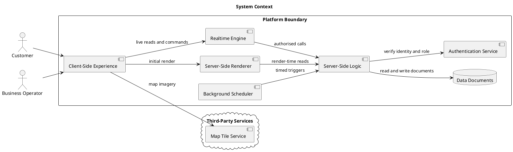

## 2. Layered Architecture

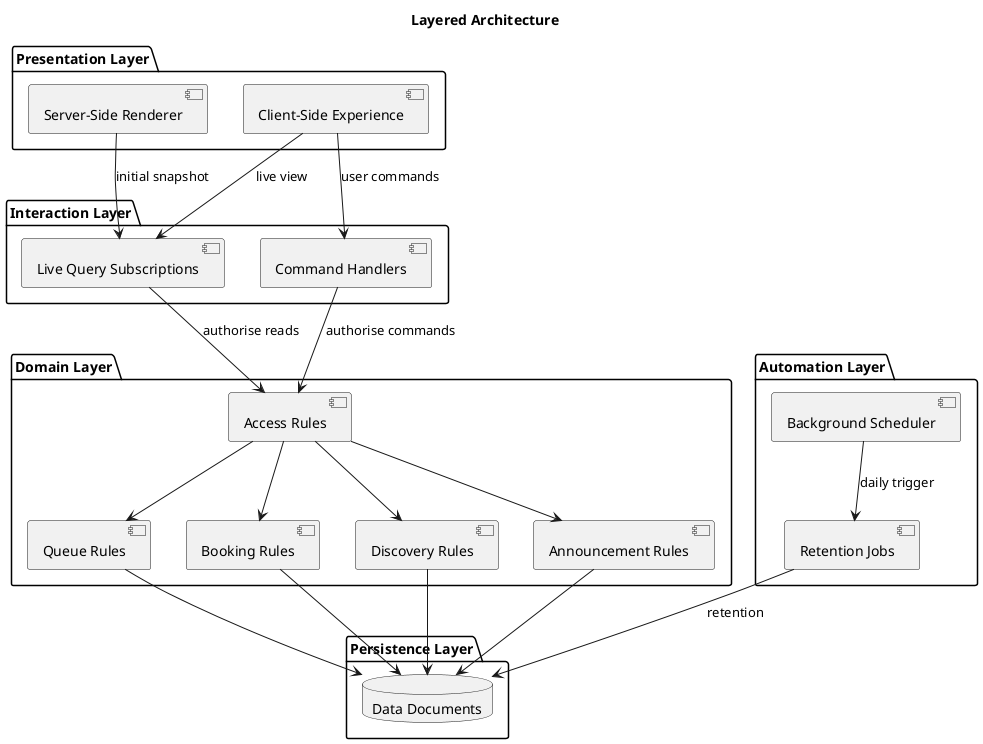

## 3. Actor Capabilities

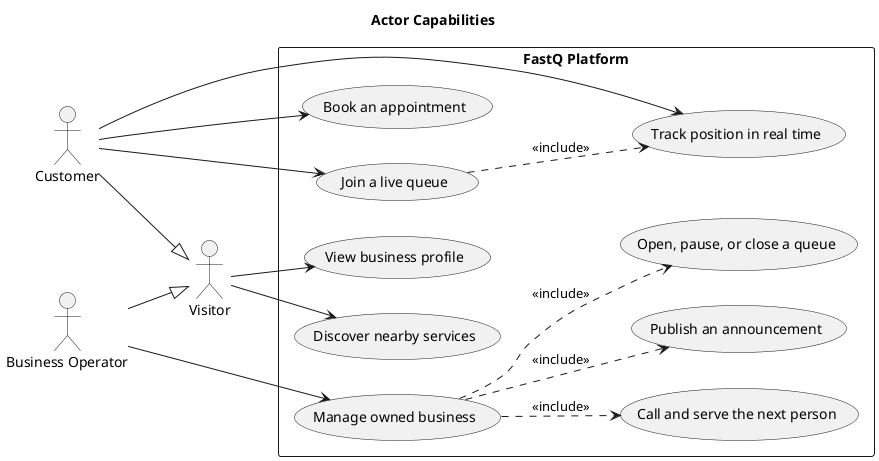

## 4. Customer Journey

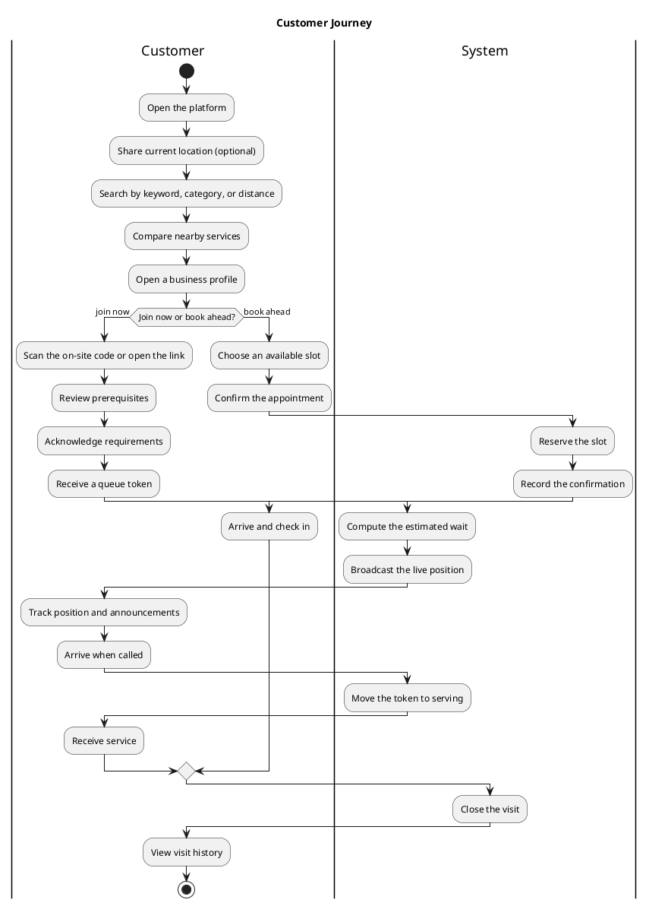

## 5. Business Onboarding and Live Operations

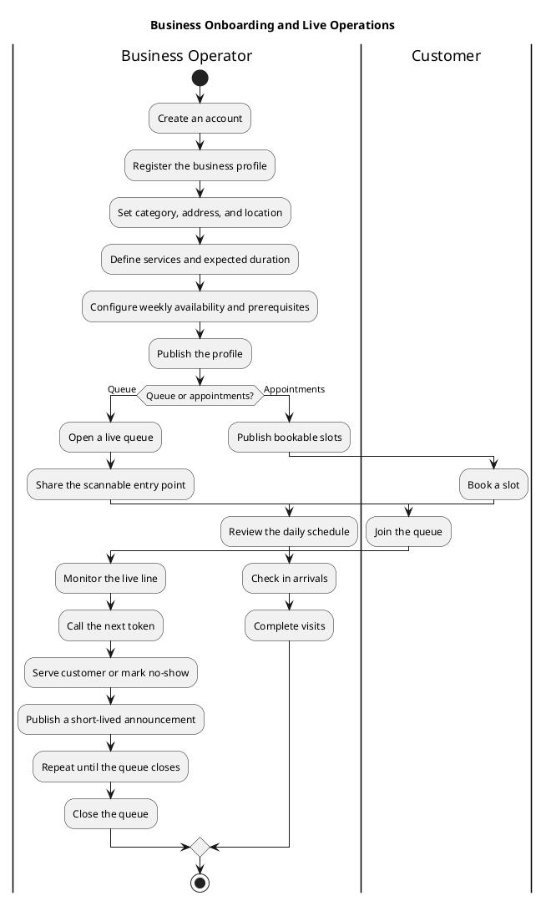

## 6. Queue Token Lifecycle

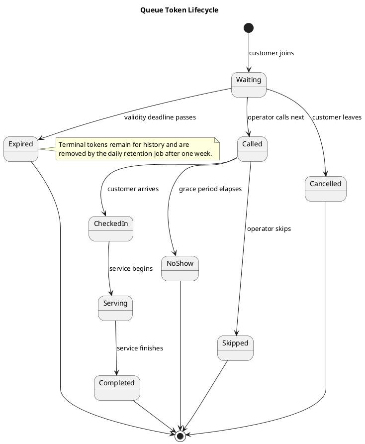

## 7. Joining a Live Queue

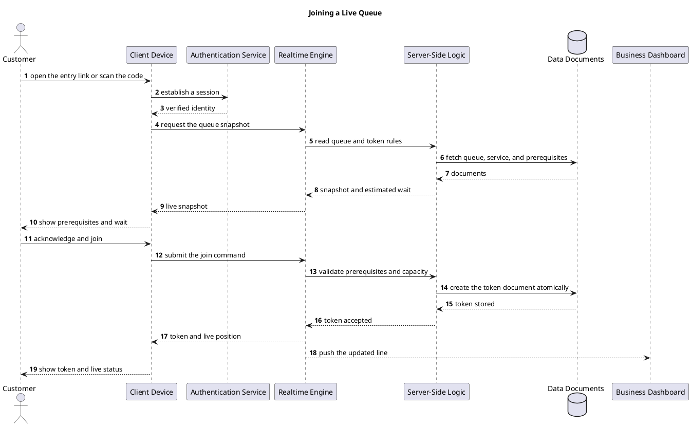

## 8. Realtime Synchronisation

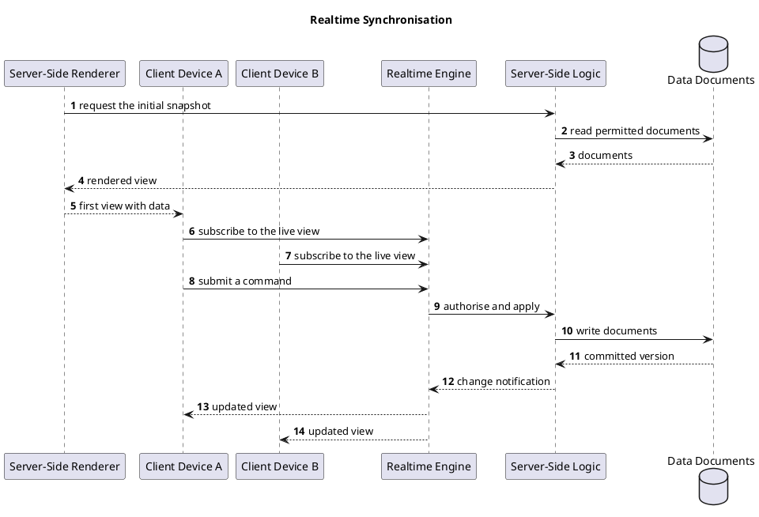

## 9. Appointment Booking

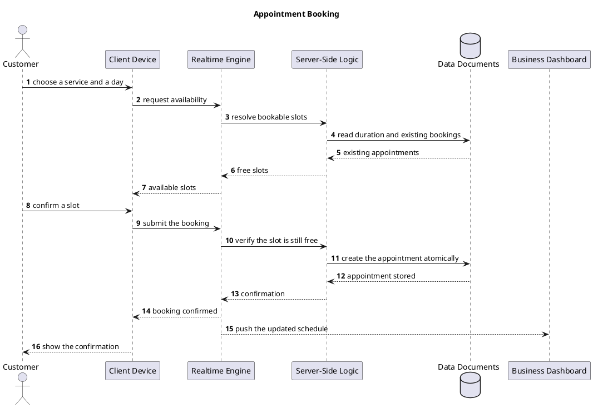

## 10. Discovery and Proximity Search

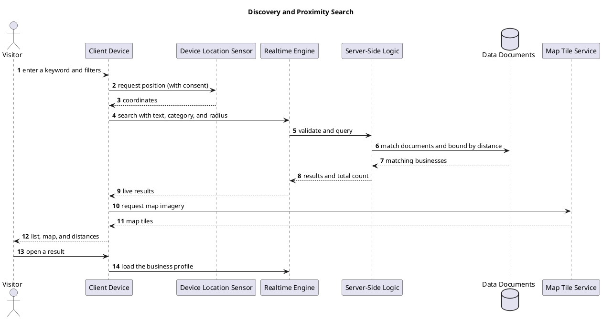

## 11. Short-Lived Announcement Broadcast

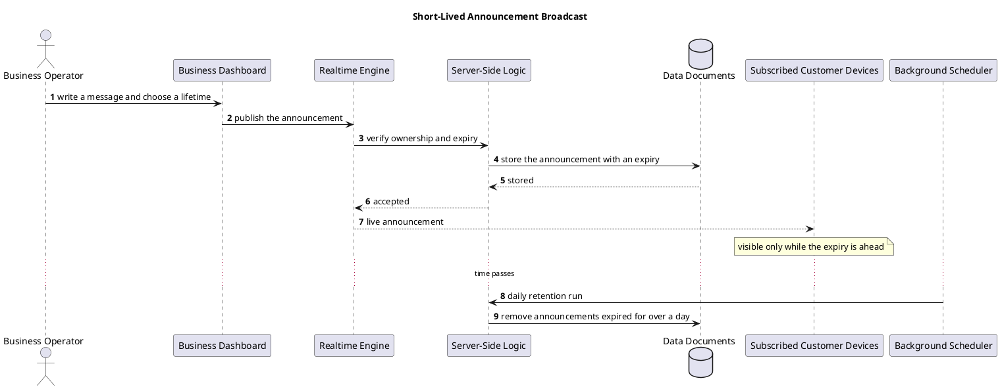

## 12. Scheduled Retention Cleanup

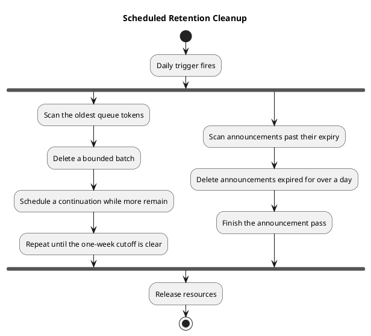

## 13. Authentication and Authorisation

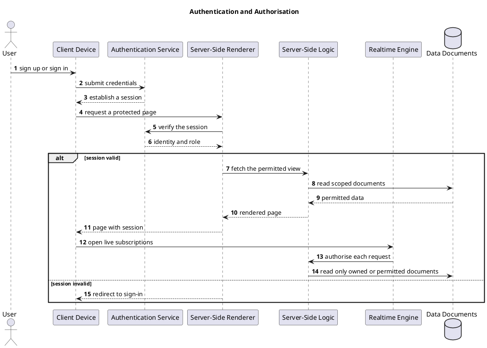

## 14. Data Model

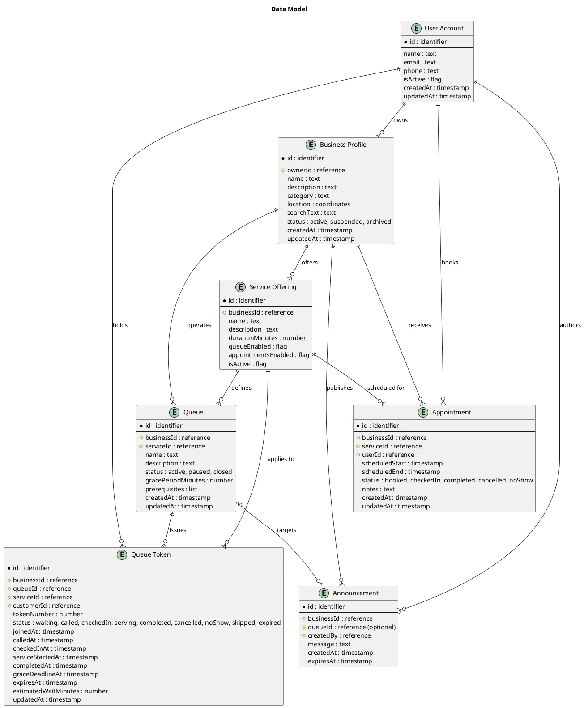

## 15. Deployment Topology

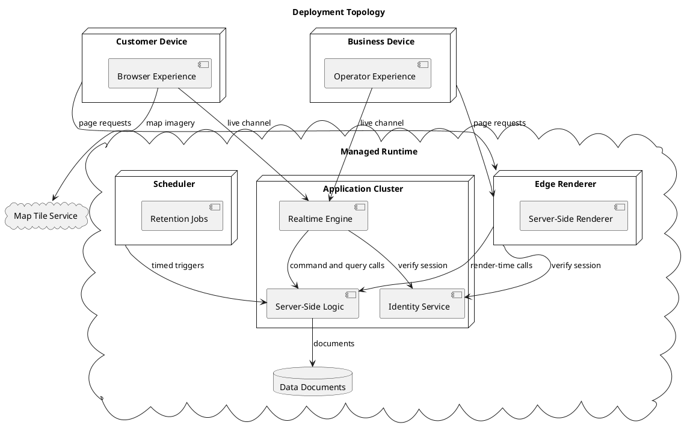
